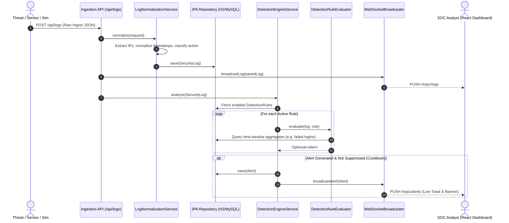
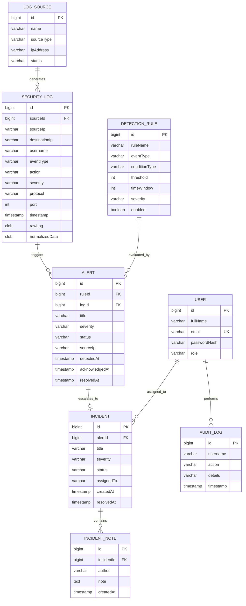

# CloudSentinel: Cloud-Based SIEM Platform
## Comprehensive Technical Documentation, Architecture, Implementation & Workflow Guide

---

## 1. Executive Summary & Project Overview

**CloudSentinel** is a modern, enterprise-grade, cloud-ready **Security Information and Event Management (SIEM)** platform designed to provide end-to-end security telemetry ingestion, log normalization, real-time multi-stage threat detection, correlation analysis, incident response management, and security operations center (SOC) visualization.

### Core Objectives
1. **Centralized Telemetry Ingestion**: Ingest diverse security logs across network devices, firewalls, identity providers (IdP/SSO), web servers, and databases.
2. **Unified Log Normalization**: Transform heterogeneous, disparate raw log formats into a standardized security schema preserving raw payloads alongside normalized fields.
3. **Real-Time Threat Detection & Correlation**: Continuously evaluate logs against configurable detection rules using an extensible strategy pattern (evaluating brute-force attempts, credential stuffing, port scans, volumetric log flooding, and multi-stage attack correlations).
4. **WebSocket-Driven SOC Command Center**: Provide instantaneous threat dispatching and live telemetry streaming to security analysts without manual page refreshing.
5. **Incident Lifecycle & SOC Governance**: Facilitate alert triage, false-positive labeling, formal incident case escalation, chronological analyst investigation notes, and immutable audit trails.
6. **Cyber Attack Simulation Lab**: Built-in interactive simulator allowing security engineers and examiners to launch simulated attacks (Brute Force, Reconnaissance Port Sweeps, and Credential Compromise Correlations) to validate detection pipelines in real-time.

---

## 2. Comprehensive Tools & Technology Stack

The project leverages a robust modern software stack organized into an enterprise decoupled architecture:

```
+-----------------------------------------------------------------------------+
|                               FRONTEND (SPA)                                |
|  React 19 | Vite 8 | Tailwind CSS v4 | Recharts 3 | StompJS | Lucide React   |
+-----------------------------------------------------------------------------+
                                       │ HTTP / REST  ▲ WebSocket (STOMP/SockJS)
                                       ▼              │
+-----------------------------------------------------------------------------+
|                             BACKEND API SERVER                              |
|   Spring Boot 3.3.3 | Spring Security 6 (JWT) | Spring Data JPA | Jackson   |
+-----------------------------------------------------------------------------+
            │                                                 │
            ▼                                                 ▼
+-----------------------+                         +-----------------------+
|  DETECTION ENGINE     |                         |      PERSISTENCE      |
|  6 Evaluators (Rules) |                         |  H2 Database / MySQL  |
+-----------------------+                         +-----------------------+
```

### 2.1 Backend Technologies & Libraries

| Technology / Library | Version | Role in Project | Non-Trivial Implementation Detail |
| :--- | :--- | :--- | :--- |
| **Java** | 21 (LTS) | Core Programming Language | Employs modern Java language features (switch expressions, records, pattern matching, `java.time` API). |
| **Spring Boot** | 3.3.3 | Core Application Framework | Powers REST APIs, dependency injection, component scanning, transaction management, and server bootstrap. |
| **Spring Security** | 6.x | Authentication & Authorization | Stateless security architecture enforcing Role-Based Access Control (RBAC) via `@EnableMethodSecurity`. |
| **JSON Web Tokens (JJWT)** | 0.12.6 | Stateless Authentication | `jjwt-api`, `jjwt-impl`, `jjwt-jackson` generate and validate signed HMAC-SHA256 tokens. |
| **Spring Data JPA / Hibernate**| 6.x | ORM & Data Access | Object-relational mapping, custom repository query methods (e.g. time-window queries), automated schema generation (`ddl-auto: update`). |
| **H2 In-Memory Database** | 2.x | Primary Development Database | High-performance in-memory RDBMS configured with `MODE=MySQL` and embedded web console (`/h2-console`). |
| **MySQL Connector/J** | 8.x / 9.x | Production Database Driver | Ready for seamless transition to AWS RDS / standalone MySQL without code modifications. |
| **Spring WebSocket & Messaging**| 3.3.3 | Real-Time Push Engine | Implements STOMP protocol over SockJS fallback (`/ws`), using `SimpMessagingTemplate` to push events to `/topic/alerts`, `/topic/logs`, and `/topic/stats`. |
| **SpringDoc OpenAPI / Swagger**| 2.6.0 | Interactive API Documentation| Auto-generates OpenAPI 3.0 specification with interactive Swagger UI (`/swagger-ui.html`). |
| **Jackson Databind** | 2.17+ | JSON Serialization & Parsing | Standardizes log schemas, serializes normalized metadata maps, and structures JSON audit records. |
| **Apache Maven** | 3.9.16 | Build Automation & Dependency Mgmt | Bundled within `tools/apache-maven-3.9.16` with a custom `mvnw.cmd` wrapper for deterministic builds without environment dependencies. |
| **Maven Surefire Plugin** | 3.2.5 | Test Execution Harness | Executes automated integration and unit test suites matching `**/*Test.java`. |

### 2.2 Frontend Technologies & Libraries

| Technology / Library | Version | Role in Project | Non-Trivial Implementation Detail |
| :--- | :--- | :--- | :--- |
| **React** | 19.2.8 | User Interface Framework | Component-based modern UI utilizing Hooks (`useState`, `useEffect`, `useContext`, `useRef`). |
| **Vite** | 8.2.2 | Build Tool & Local Dev Server | Extremely fast Hot Module Replacement (HMR) and optimized Rollup-based production bundling. |
| **Tailwind CSS** | 4.3.3 | Utility-First CSS Framework | Modern SOC dark-mode aesthetic (slate/cyan/rose palette, glassmorphism, responsive grid layouts). |
| **@tailwindcss/postcss & PostCSS**| 4.3.3 / 8.5.26 | CSS Pipeline Engine | Processes modern CSS syntax, nesting, and vendor prefixing. |
| **React Router DOM** | 7.18.3 | Client-Side Routing | Provides declarative route definitions, nested layouts (`<Layout />`), and authentication route guarding (`<ProtectedRoute />`). |
| **@stomp/stompjs** | 7.3.0 | STOMP WebSocket Client | Connects to backend broker, maintains subscriptions, and receives real-time security alerts. |
| **sockjs-client** | 1.6.1 | WebSocket Transport Fallback | Provides reliable WebSocket emulation over HTTP long-polling if native sockets are blocked by corporate proxies. |
| **Recharts** | 3.10.1 | Data Visualization & Analytics | Renders interactive SOC charts: AreaChart (events over time), BarChart (logs by source), and PieChart (alerts by severity). |
| **Axios** | 1.20.0 | REST HTTP Client | Centralized instance with request interceptors for automatic JWT injection and response interceptors for token expiration handling. |
| **Lucide React** | 1.39.0 | SOC & Security Iconography | Clean, accessible vector icons for severity levels, statuses, terminal views, and telemetry graphs. |
| **Oxlint** | 1.79.0 | High-Speed JS/React Linter | Next-generation Rust-based linter ensuring clean code practices and preventing runtime defects. |

---

## 3. System Architecture & High-Level Design

### 3.1 End-to-End Architectural Data Flow



---

## 4. Detailed Component Implementation Breakdown

### 4.1 Log Ingestion & Normalization Engine

Heterogeneous devices emit logs in diverse naming formats. CloudSentinel's `LogNormalizationService` handles loose attribute binding to normalize diverse event structures into a standardized `SecurityLog` entity:

* **Field Fallbacks**: Resolves Source IP from `sourceIp`, `src`, or `client_ip` (defaulting to `127.0.0.1`). Resolves Destination IP from `destinationIp` or `dst`. Resolves User from `username` or `user`.
* **Action Classification**: Heuristically maps message contents containing keywords (`FAIL`, `INVALID`, `BAD_CRED`) to `LOGIN_FAILED`, keywords (`SUCCESS`, `ALLOWED`) to `LOGIN_SUCCESS`, and firewall keywords (`BLOCK`, `DROP`, `DENY`) to `CONNECTION_BLOCKED`.
* **Event Type Categorization**: Automatically categorizes logs into `LOGIN`, `FIREWALL`, `PORT_ACCESS`, `DATABASE`, `NETWORK`, or `APPLICATION`.
* **Severity Normalization**: Parses `CRIT`, `FATAL`, `EMERGENCY` &rarr; `CRITICAL`; `HIGH`, `ERR` &rarr; `HIGH`; `MED`, `WARN` &rarr; `MEDIUM`; others &rarr; `LOW`.
* **Data Preservation**: Stores the unmodified raw incoming JSON in `rawLog` while generating structured, indexed search parameters in `normalizedData`.

### 4.2 The Rule-Based Detection Engine

The detection architecture utilizes the **Strategy Design Pattern** via `DetectionRuleEvaluator`:

```
                           +------------------------------+
                           |  <<DetectionRuleEvaluator>>  |
                           |  + supports(ConditionType)   |
                           |  + evaluate(log, rule)       |
                           +------------------------------+
                                          ▲
          ┌───────────────────────┬───────┴───────────────┬───────────────────────┐
          │                       │                       │                       │
+-------------------+   +-------------------+   +-------------------+   +-------------------+
| BruteForceRule    |   | SuspiciousPort    |   | CriticalEvent     |   | CorrelationRule   |
| Evaluator         |   | Evaluator         |   | Evaluator         |   | Evaluator         |
| (FAILED_LOGINS)   |   | (SUSPICIOUS_PORT) |   | (CRITICAL_EVENT)  |   | (CORRELATION)     |
+-------------------+   +-------------------+   +-------------------+   +-------------------+
```

#### The 6 Core Detection Evaluators:
1. **BruteForceRuleEvaluator (`FAILED_LOGINS`)**:
   - Triggers when an incoming log has action `LOGIN_FAILED`.
   - Queries `SecurityLogRepository.countBySourceIpAndActionAndTimestampAfter(...)`.
   - Fires an alert if `failedCount >= rule.threshold` within the sliding `rule.timeWindow` (e.g., &ge; 5 failed logins within 5 minutes).
2. **RepeatedLoginRuleEvaluator (`FAILED_LOGINS_SAME_USER`)**:
   - Focuses on targeted account takeover and credential stuffing.
   - Evaluates failed logins clustered against a single targeted username across arbitrary source IPs.
3. **SuspiciousPortRuleEvaluator (`SUSPICIOUS_PORT`)**:
   - Inspects target connection ports against a catalog of high-risk services:
     - `Port 22` (SSH Probe / Brute force)
     - `Port 23` (Telnet Insecure Remote Access)
     - `Port 1433` (MS-SQL Database Exposure)
     - `Port 3389` (RDP Remote Desktop Exposure)
     - `Port 4444 / 4445` (Metasploit / Reverse Shell Listener)
     - `Port 5900` (VNC Exposure)
     - `Port 6667` (IRC Botnet Command & Control)
4. **CriticalEventRuleEvaluator (`CRITICAL_EVENT`)**:
   - Immediately escalates any ingested telemetry explicitly labeled with `CRITICAL` severity without waiting for threshold accumulations.
5. **RepeatedEventRuleEvaluator (`REPEATED_EVENT`)**:
   - Evaluates volumetric log flooding and DoS indicators where a single source emits more than 20 events within 5 minutes.
6. **CorrelationRuleEvaluator (`CORRELATION`)**:
   - Multi-stage attack detection: Listens for a `LOGIN_SUCCESS` action, then checks if that specific source IP accumulated &ge; 5 failed logins within the preceding window.
   - Triggers a **CRITICAL Severity Alert**: *"Possible Brute Force Attack Followed by Successful Login (Potential Account Takeover)"*.

#### Alert Deduplication & Fatigue Suppression:
To prevent overwhelming the SOC with duplicate alerts during an ongoing attack, `DetectionEngineService` checks:
```java
int cooldownMinutes = Math.max(rule.getTimeWindow(), 3);
LocalDateTime cooldownCutoff = LocalDateTime.now().minusMinutes(cooldownMinutes);
boolean isDuplicate = alertRepository.existsBySourceIpAndRuleIdAndDetectedAtAfter(
        alert.getSourceIp(), rule.getId(), cooldownCutoff);
```
If an active alert exists for that rule and IP within the cooldown period, duplicate alerts are suppressed.

### 4.3 Incident Lifecycle & Investigation Workflow

Alerts represent raw anomalies detected by rules. High-priority alerts are escalated into formal **Incidents**:

```
[ Ingest Log ] ──> [ Rule Triggered ] ──> [ Alert: NEW ]
                                                │
                                    ┌───────────┴───────────┐
                                    ▼                       ▼
                           [ FALSE_POSITIVE ]      [ ACKNOWLEDGED ]
                                                            │
                                                            ▼
                                                   [ Create Incident ]
                                                            │
                                              ┌─────────────┴─────────────┐
                                              ▼                           ▼
                                      Status: OPEN             Status: IN_PROGRESS
                                              │                           │
                                              └─────────────┬─────────────┘
                                                            ▼
                                                    Status: RESOLVED
                                                            │
                                                            ▼
                                                     Status: CLOSED
```

* **Alert Statuses**: `NEW` &rarr; `ACKNOWLEDGED` &rarr; `RESOLVED` or `FALSE_POSITIVE`.
* **Incident Statuses**: `OPEN` &rarr; `IN_PROGRESS` &rarr; `RESOLVED` &rarr; `CLOSED`.
* **Investigation Notes**: Analysts append timestamped, authored notes (`IncidentNote`) detailing root cause, containment steps, and firewall IP block verification.
* **Audit Trail**: All status transitions, case assignments, and note entries generate immutable records in the `AuditLog` table.

### 4.4 Real-Time WebSockets Communication

The platform uses Spring's `SimpMessagingTemplate` to push real-time updates over STOMP:
* `/topic/alerts`: Broadcasts new `Alert` records. The frontend displays immediate toast popups and increments live notification badges.
* `/topic/logs`: Broadcasts incoming normalized logs to the live stream view in the SOC console.
* `/topic/stats`: Broadcasts updated metric totals (total events, critical alerts, open incidents).

---

## 5. Security & Authentication Architecture

### 5.1 Stateless JWT Authentication Flow
1. **Client Request**: Frontend POSTs credentials (`admin@cloudsentinel.com` / password) to `/api/auth/login`.
2. **Authentication**: `AuthenticationManager` verifies credentials against BCrypt-hashed passwords in the database.
3. **Token Generation**: `JwtTokenProvider` signs an HMAC-SHA256 JWT embedding the username, roles, and issue/expiration timestamps (default validity: 24 hours).
4. **Token Interception**: For subsequent requests, `JwtAuthenticationFilter` extracts the `Authorization: Bearer <token>` header, validates the signature, extracts the user principal, and populates the `SecurityContextHolder`.

### 5.2 Role-Based Access Control (RBAC) Matrix

| Endpoint Route / Feature | HTTP Method | Permitted Roles | Notes |
| :--- | :--- | :--- | :--- |
| `/api/auth/**` | POST | Public (PermitAll) | Login & token acquisition |
| `/api/logs` | POST | Public (PermitAll) | Ingestion point for remote log agents/sensors |
| `/api/demo/**` | POST | Public (PermitAll) | Attack lab simulation triggers |
| `/ws/**` | GET / POST | Public (PermitAll) | WebSocket handshake endpoint |
| `/swagger-ui/**`, `/v3/api-docs/**` | GET | Public (PermitAll) | Interactive OpenAPI docs |
| `/h2-console/**` | ALL | Public (PermitAll) | Development database console |
| `/api/dashboard/**` | GET | `ADMIN`, `ANALYST` | Aggregated analytics & charts |
| `/api/logs/**` | GET | `ADMIN`, `ANALYST` | Log exploration and filtering |
| `/api/alerts/**` | GET, PATCH | `ADMIN`, `ANALYST` | Alert viewing and status updates |
| `/api/incidents/**` | GET, POST, PATCH | `ADMIN`, `ANALYST` | Incident management and notes |
| `/api/rules/**` | GET | `ADMIN`, `ANALYST` | Viewing active detection rules |
| `/api/rules/**` | POST, PUT, DELETE | `ADMIN` only | Creating or tuning detection rules |
| `/api/sources/**` | POST, PUT, DELETE | `ADMIN` only | Provisioning new log sources |
| `/api/users/**` | ALL | `ADMIN` only | User account administration |
| `/api/audit-logs/**` | GET | `ADMIN` only | SOC compliance audit trail |

---

## 6. Database Schema & Entity Relationships



---

## 7. Execution, Setup & Deployment Guide

### 7.1 Quick Start (One-Click Launchers)

Two dedicated Windows batch scripts are provided in the project root:

1. **`run.bat`**:
   - Automatically verifies your `Java` and `Node.js` environments.
   - Installs frontend `node_modules` if not already present.
   - Launches the **Spring Boot Backend** in a dedicated window on port `8088`.
   - Launches the **Vite React Frontend** in a dedicated window on port `5173`.
   - Displays all URLs and demo credentials, waits 7 seconds, and automatically opens your web browser to `http://localhost:5173`.
   ```powershell
   # In project root:
   .\run.bat
   ```

2. **`stop.bat`**:
   - Gracefully finds and terminates processes listening on ports `8088` (Backend) and `5173` (Frontend).
   ```powershell
   # In project root:
   .\stop.bat
   ```

---

### 7.2 Prerequisites

The project includes a bundled Apache Maven binary at `tools/apache-maven-3.9.16` and a Windows batch script `mvnw.cmd` in the `backend` directory.

#### Option A: Using the project's bundled Maven wrapper (Windows PowerShell / CMD)
```powershell
cd "m:\5 sem\Cloud Based SIEM Platform\backend"
.\mvnw.cmd spring-boot:run
```

#### Option B: Using system-installed Maven
```powershell
cd "m:\5 sem\Cloud Based SIEM Platform\backend"
mvn clean spring-boot:run
```

#### Backend Verification Endpoints:
* **API Base URL**: `http://localhost:8088/api`
* **Swagger UI Documentation**: `http://localhost:8088/swagger-ui.html`
* **OpenAPI Raw Specification**: `http://localhost:8088/v3/api-docs`
* **H2 Database Console**: `http://localhost:8088/h2-console`
  - *JDBC URL*: `jdbc:h2:mem:cloudsentinel;DB_CLOSE_DELAY=-1;DB_CLOSE_ON_EXIT=FALSE;MODE=MySQL`
  - *Username*: `sa`
  - *Password*: *(leave blank)*

---

### 7.3 Running the Frontend

```powershell
cd "m:\5 sem\Cloud Based SIEM Platform\frontend"

# 1. Install dependencies (if not already installed)
npm install

# 2. Launch Vite development server
npm run dev
```

* **Frontend Application URL**: `http://localhost:5173`
* Network connections and API targets are configured in `frontend/.env`:
  ```env
  VITE_API_URL=http://localhost:8088/api
  VITE_WS_URL=http://localhost:8088/ws
  ```

---

### 7.4 Pre-Configured Demonstration Accounts

The platform automatically bootstraps sample accounts on startup via `DataInitializer.java`:

| Role | Email Address | Password | Permissions |
| :--- | :--- | :--- | :--- |
| **SOC Administrator** | `admin@cloudsentinel.com` | `Admin@123` | Full access (Rules, Sources, User Admin, Audit Logs, Analytics) |
| **Security Analyst** | `analyst@cloudsentinel.com` | `Analyst@123` | Operational access (Dashboard, Logs, Alert Triage, Incident Notes) |

---

## 8. Interactive Testing & Verification Guide

### 8.1 Simulating Cyber Attacks via the Attack Lab
1. Log in to the frontend at `http://localhost:5173` using `admin@cloudsentinel.com` / `Admin@123`.
2. Navigate to **Simulation** (`/simulation`) from the left sidebar.
3. **Test 1: Distributed Brute Force Attack**:
   - Enter an IP (e.g. `192.168.1.105`) and click **Launch Attack**.
   - Generates 6 rapid failed login attempts for `admin`.
   - **Result**: Triggers a `HIGH` severity alert *Possible Brute Force Attack* within seconds; real-time toast pops up on screen.
4. **Test 2: Reconnaissance Port Scan**:
   - Enter an IP (e.g. `10.10.4.52`) and click **Launch Port Scan**.
   - Generates probes against ports `22, 23, 3389, 4444`.
   - **Result**: Triggers `HIGH` severity alert *Suspicious Port Access Detected* naming the target service (SSH/Telnet/RDP).
5. **Test 3: Credential Breach Correlation**:
   - Enter an IP (e.g. `172.16.8.99`) and click **Execute Correlation**.
   - Injects 5 failed SSH authentication attempts followed immediately by a successful login for account `root`.
   - **Result**: Triggers a `CRITICAL` severity alert *Possible Brute Force Attack Followed by Successful Login*.

### 8.2 Ingesting External Logs via REST API (cURL)
You can ingest external logs directly from any terminal or remote agent:

```bash
curl -X POST http://localhost:8088/api/logs \
  -H "Content-Type: application/json" \
  -d '{
    "sourceId": 1,
    "sourceName": "External Edge Gateway",
    "sourceIp": "203.0.113.88",
    "destinationIp": "10.0.1.10",
    "username": "root",
    "eventType": "LOGIN",
    "action": "LOGIN_FAILED",
    "severity": "HIGH",
    "message": "Failed SSH login for user root",
    "protocol": "SSH",
    "port": 22
  }'
```

---

## 9. Directory & File Organization Reference

```
Cloud Based SIEM Platform/
│
├── PROJECT_DOCUMENTATION.md             # This comprehensive technical guide
│
├── tools/                               # Bundled development tools
│   └── apache-maven-3.9.16/             # Standalone Apache Maven distribution
│
├── backend/                             # Spring Boot 3.3.3 Backend
│   ├── mvnw.cmd                         # Batch script delegating to tools/maven
│   ├── pom.xml                          # Maven build descriptors & dependencies
│   └── src/
│       ├── main/
│       │   ├── java/com/cloudsentinel/
│       │   │   ├── CloudSentinelApplication.java
│       │   │   ├── config/              # SecurityConfig, WebSocketConfig, DataInitializer
│       │   │   ├── controller/          # REST Controllers (Auth, Logs, Alerts, Incidents, Demo)
│       │   │   ├── detection/           # DetectionEngineService & Rule Evaluator classes
│       │   │   │   └── evaluators/      # BruteForce, PortScan, Correlation, Critical, etc.
│       │   │   ├── dto/                 # Request & Response Data Transfer Objects
│       │   │   ├── entity/              # JPA Entities (SecurityLog, Alert, Incident, User, etc.)
│       │   │   ├── exception/           # Custom exceptions & GlobalExceptionHandler
│       │   │   ├── normalization/       # LogNormalizationService
│       │   │   ├── repository/          # Spring Data JPA Repositories
│       │   │   ├── security/            # JWT Token Provider, UserDetailsService, AuthFilter
│       │   │   ├── service/             # Business services (AlertService, IncidentService, etc.)
│       │   │   └── websocket/           # WebSocketAlertBroadcaster (STOMP template)
│       │   └── resources/
│       │       └── application.yml      # Port 8088, DB config, JWT keys, logging levels
│       └── test/                        # Integration and unit tests
│
└── frontend/                            # React 19 + Vite 8 SPA
    ├── package.json                     # Frontend dependencies & build scripts
    ├── vite.config.js                   # Vite configuration & React plugin
    ├── tailwind.config.js               # Tailwind styling rules & color themes
    ├── index.html                       # HTML entry point
    └── src/
        ├── App.jsx                      # Main route orchestrator
        ├── main.jsx                     # DOM mount point
        ├── components/                  # Navbar, Sidebar, Badges, Modals, StatCards, Toast
        ├── context/                     # AuthContext, WebSocketContext (SockJS + STOMP)
        ├── pages/                       # Dashboard, Logs, Alerts, Incidents, Rules, Simulation
        └── services/                    # Axios API service clients (auth, logs, alerts, demo)
```

---
*Documentation compiled for CloudSentinel SIEM Platform.*
